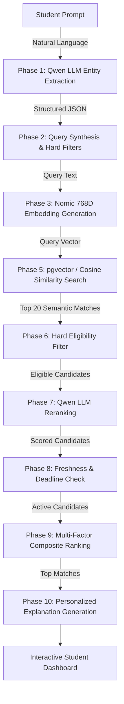

# InternAI — Agentic RAG Internship Recommendation System

An intelligent, multi-stage **Retrieval-Augmented Generation (RAG)** agent that matches students with internships using natural language understanding, semantic vector search, hard academic eligibility filtering, LLM reranking, and explainable recommendations.

---

## 📌 Architecture & Pipeline

InternAI implements an **Agentic 10-Phase Multi-Stage RAG Pipeline**:



---

## 🤖 Deep Learning & AI Models Used

| Component | Model / Technology | Description |
| :--- | :--- | :--- |
| **Embedding Model** | **`nomic-embed-text`** | Generates 768-dimensional dense vectors via Ollama |
| **Generative LLM** | **`qwen2.5:1.5b`** | Requirement extraction, relevance reranking, and explanations |
| **Vector Database** | **PostgreSQL + pgvector** | IVFFlat cosine similarity search (`<=>`) with local in-memory fallback |
| **Backend Gateway** | **Node.js (Express)** | API Gateway, static frontend serving, port `5000` |
| **AI Microservice** | **Python (Flask)** | Orchestrates the 10-phase pipeline, port `5001` |

---

## 🚀 Key Features

* **Natural Language Query Understanding**: Students describe what they want in everyday language (e.g., *"3rd year CSE student looking for a paid AI internship in Chennai or remote"*).
* **Deterministic Eligibility Filtering**: Strict enforcement of branch, academic year, and prior experience.
* **LLM Cross-Encoder Reranking**: Uses Qwen to deeply score semantic fit beyond surface keyword similarity.
* **Multi-Factor Ranking Formula**:
  * **30%**: Semantic Vector Similarity
  * **25%**: LLM Reranker Score
  * **20%**: Eligibility Fit
  * **15%**: Deadline & Freshness
  * **10%**: Preferences (stipend, work mode)
* **Explainable AI (XAI)**: Generates clear, bullet-pointed justifications for each match with visual percentage score breakdowns.
* **Organization Portal**: Organizations can post internships, automatically generating 768D embeddings on submission.

---

## 🛠️ Project Structure

```
├── backend/
│   ├── ai/
│   │   ├── ai_server.py           # Flask AI Microservice (Port 5001)
│   │   ├── pipeline.py            # Master 10-Phase Pipeline Orchestrator
│   │   ├── embedding_service.py   # nomic-embed-text integration via Ollama
│   │   ├── vector_store.py        # pgvector & in-memory cosine search
│   │   ├── queryAgent.js          # Phase 1 Qwen LLM extraction
│   │   ├── query_builder.py       # Phase 2 query synthesis
│   │   ├── eligibility_filter.py  # Phase 6 rule-based academic filter
│   │   ├── reranker.py            # Phase 7 Qwen LLM reranker
│   │   ├── freshness_checker.py   # Phase 8 deadline verification
│   │   ├── final_ranker.py        # Phase 9 weighted composite ranking
│   │   ├── explainer.py           # Phase 10 explanation synthesizer
│   │   └── requirements.txt       # Python dependencies
│   └── server.js                  # Node.js API Gateway (Port 5000)
├── data/
│   ├── internships.json           # Active database with 768D vectors
│   └── internships_seed.json      # Initial seed dataset
├── frontend/
│   ├── index.html                 # Student discovery interface
│   ├── app.js                     # Interactive search & phase tracker
│   ├── style.css                  # UI styling
│   ├── organization.html          # Organization internship portal
│   └── organization.js            # Submission & embedding sync
├── start-all.ps1                  # Single-command startup script
├── stop-all.ps1                   # Single-command shutdown script
└── README.md
```

---

## 💻 Getting Started

### 1. Prerequisites
* **Node.js** (v18+)
* **Python** (v3.10+)
* **Ollama** installed with models:
  ```bash
  ollama pull nomic-embed-text
  ollama pull qwen2.5:1.5b
  ```

### 2. Setup Dependencies
```bash
# Backend dependencies
cd backend
npm install

# Python dependencies
cd ai
pip install -r requirements.txt
```

### 3. Run the Application
Start all services with one command:
```powershell
powershell -ExecutionPolicy Bypass -File .\start-all.ps1
```

This starts:
- Ollama on `http://localhost:11434`
- Flask AI Microservice on `http://localhost:5001`
- Node.js Backend on `http://localhost:5000`
- Automatically opens the web application in your browser.

### 4. Stop the Application
```powershell
powershell -ExecutionPolicy Bypass -File .\stop-all.ps1
```
